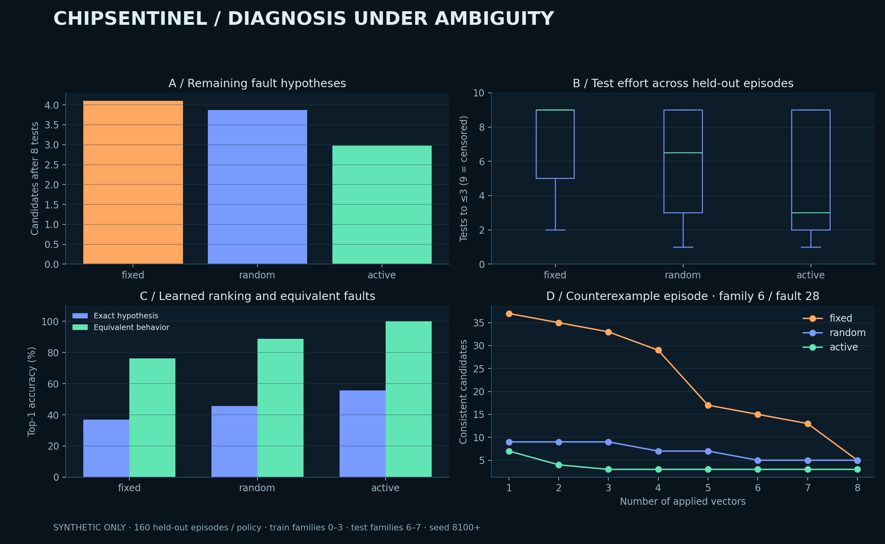
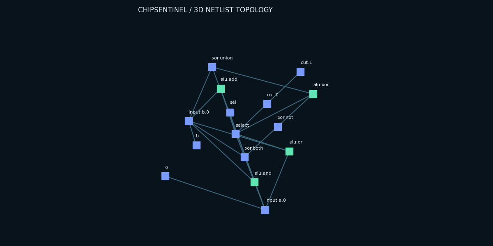
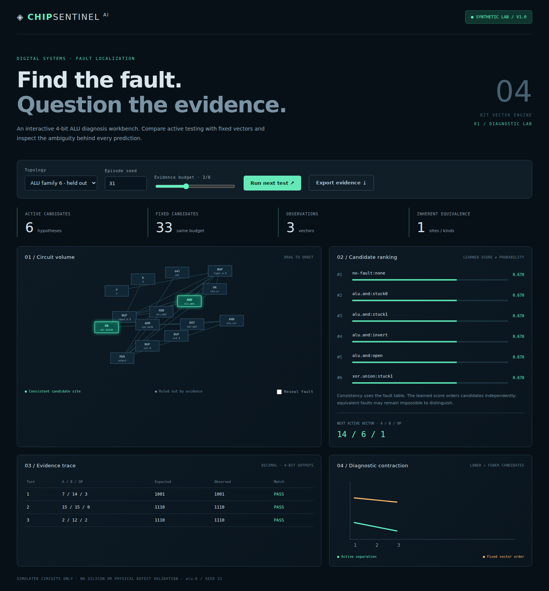

# Problem Statement

[](https://github.com/mirmoosa1014-rgb/chip-sentinel-ai/actions/workflows/ci.yml)

**Can informative test vectors narrow the possible faults in a digital ALU faster, and can a learned candidate ranker resolve the remaining ambiguity?** ChipSentinel AI is a local, interactive diagnostic laboratory for synthetic 4-bit circuits. Inputs are a topology and observed input/output tests; outputs are consistent fault hypotheses, learned ranking scores, and the next information-seeking vector. Success is measured by tests required to reach three candidates, final candidate count, and exact versus equivalence-aware localization.



**Synthetic circuits only.** This project does not diagnose physical silicon. A fault hypothesis is a whole 4-bit bus fault, not an individual transistor defect. Open wires deterministically read zero, so they are intentionally equivalent to stuck-at-zero at the same site.

## Workbench

The React/TypeScript interface offers a draggable **3D circuit graph**, candidate heatmap, learned rank list, binary expected/observed trace, active-versus-fixed contraction plot, reproducible seed controls, a fault reveal toggle, and JSON evidence export. All displayed observations come from the Python simulator. The figures below are generated from real simulator outputs, not screenshots.





## Run locally

Requires Python 3.11+ and Node 22+. The default backend has no third-party runtime dependencies.

```bash
python3 -m venv .venv
source .venv/bin/activate
npm ci --prefix frontend
npm run build --prefix frontend
python -m chipsentinel.server
```

Open **http://127.0.0.1:8101**. For frontend development, start the backend and run `npm run dev --prefix frontend` in another terminal; Vite uses port 5101 and proxies the API.

Optional FastAPI service (API only):

```bash
pip install -r requirements.txt
uvicorn chipsentinel.api:app --host 127.0.0.1 --port 8101
```

The standard server serves both the built frontend and `/api/diagnose`; the optional FastAPI adapter exposes the API independently. Requests are bounded to eight tests and eight topology families. Superseded UI requests are cancelled; benchmarks are short, bounded CLI jobs and can be interrupted with Ctrl+C.

## Measured findings

The included full benchmark applies eight vectors per episode to **160 paired held-out episodes per policy** (families 6–7). Training uses only families 0–3. Families 4–5 are reserved for validation; no hyperparameter search was performed. Every policy receives the same family/fault episodes; vector choices differ by policy. The fixed baseline interleaves all four operations across boundary and alternating-bit patterns; random draws from the same pool of 48 vectors. Active selection maximizes the entropy of candidate output partitions using only current evidence and the fault table.

| Policy | Final candidates ↓ | Tests to ≤3 ↓ | ML exact top-1 | Consistency exact top-1 | ML equivalent top-1 |
|---|---:|---:|---:|---:|---:|
| Fixed | 4.100 | 7.206 | 36.9% | 37.5% | 76.2% |
| Random | 3.875 | 5.750 | 45.6% | 41.2% | 88.8% |
| Active | 2.981 | 4.112 | 55.6% | 51.2% | 100.0% |

Tests-to-three is capped at 9 when not reached within the eight-test budget; it is a censored effort score, not a literal ninth observation. The ML ranker and consistency baseline are evaluated on the **same observations**, with deterministic index order breaking baseline ties. Exact-hypothesis accuracy is stricter than component-site accuracy and penalizes indistinguishable fault kinds. The results do **not** demonstrate that ML improves active test selection: the active policy is a non-learned model-based heuristic. The learned ranker can fail and cannot disambiguate equal signatures.

[Raw episode CSV](results/episodes.csv) · [metrics, counterexamples, and normal-circuit checks](results/metrics.json) · [small trained model](models/ranker.json)

## Reproduce and verify

```bash
python -m unittest discover -s tests -v
python -m chipsentinel.experiment          # quick: 30 paired episodes / policy
python -m chipsentinel.experiment --full   # full: 160 paired episodes / policy
pip install -r requirements.txt            # optional plotting / FastAPI dependencies
python -m chipsentinel.visuals
npm run build --prefix frontend
```

All 11 tests pass: the original nine unit checks plus real HTTP and optional FastAPI integration checks, including exhaustive arithmetic-oracle comparisons for all 8 × 1,024 topology/input combinations, invalid netlists, bus faults, parallel register updates, replay, equivalence, normal specificity, split identity, model output, and API bounds. TypeScript and the production build pass. The recovered Linux project also passes real loopback HTTP static/API smoke checks and FastAPI TestClient health/simulation/validation checks. Dependency installation and lockfile regeneration succeeded. The CI badge below reports hosted verification status. Real headless-browser checks pass for initial live API rendering, next-test updates, fault reveal, 3D dragging, JSON transcript download, and mobile layout without horizontal overflow. Authentic desktop/mobile app screenshots were captured and visually inspected during verification. The scientific figures and orbit animation are genuine output-derived artifacts.

## Architecture and research notes

- [Architecture and v1 semantics](docs/architecture.md)
- [Model card and feature schema](docs/model.md)
- [Evaluation and caveats](docs/evaluation.md)
- [Explanation and reviewer questions](docs/explain.md)
- [90-second demo](docs/demo.md)
- [Project summary](docs/project-summary.md)
- [Recovery and current progress](docs/progress.md)

Limitations include a small topology space, deterministic noiseless observations, single bus faults, no timing or metastability, no multi-fault episodes, fixed-size circuits, and limited independent normal-circuit scenarios. The register bank is tested separately; the UI diagnoses the combinational ALU, not sequential faults. No physical hardware, real users, awards, or field validation are claimed. Wider-ALU, per-bit faults, noisy evidence and learned active selection remain future work.

## References

- [NASA/JPL ASIC Guide: Design for Test](https://parts.jpl.nasa.gov/asic/Sect.3.3.html) — structural stuck-at testing context.
- [NPTEL: Fault Equivalence](https://archive.nptel.ac.in/content/storage2/courses/106103016/module7/lec3/1.html) — equivalent faults motivate set-valued diagnosis.
- [FastAPI testing documentation](https://fastapi.tiangolo.com/tutorial/testing/) — optional API adapter integration pattern.

## Authorship and publication

Moosa supplied project direction and requested implementation, visualizations, and documentation. AI agents implemented substantial code and analysis; review and hardware validation are not implied. Source, reproducible experiments and visual evidence are available in the repository linked below.


## Repository

[Source and releases](https://github.com/mirmoosa1014-rgb/chip-sentinel-ai) · [Continuous integration](https://github.com/mirmoosa1014-rgb/chip-sentinel-ai/actions)
